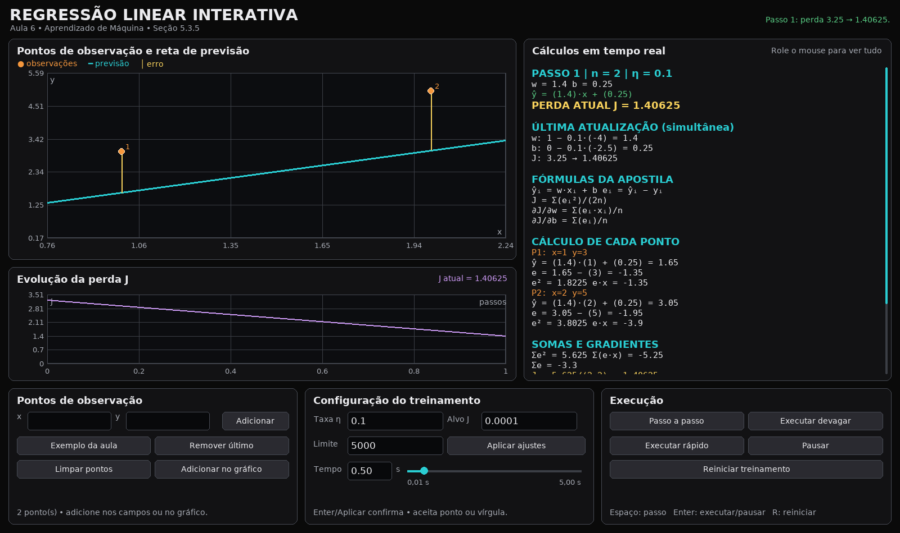

# Regressão Linear Interativa — Aula 6

Aplicação em Python para acompanhar, passo a passo, como a descida do gradiente ajusta uma reta aos pontos de observação. O exemplo inicial reproduz a subseção **5.3.5 — Como o treinamento modifica um modelo** da apostila de Introdução à Inteligência Artificial.

A interface foi construída com Pygame, janela redimensionável, tema escuro, controles de passo e execução com intervalo configurável. Os componentes de botão, controle de tempo e ajuste de DPI foram adaptados desse exemplo.



## Recursos

- Gráfico com pontos de observação, reta de previsão e segmentos que representam os erros de cada ponto.
- Gráfico da perda em função dos passos de treinamento.
- Painel de cálculos com fórmulas, previsão, erro, erro ao quadrado e contribuição para o gradiente de **cada ponto**; somas, perda, gradientes e atualização simultânea de `w` e `b`.
- Exibição do estado atual, da última atualização e do cálculo previsto para o próximo passo. Use a roda do mouse sobre o painel para ver todo o conteúdo.
- Inclusão de até 100 pontos pelas coordenadas ou clicando no gráfico; remoção do último ponto; limpeza e restauração do exemplo da aula.
- Taxa de aprendizado, perda alvo e limite de passos configuráveis.
- Passo a passo, execução automática com tempo ajustável de **0,01 a 5,00 segundos**, execução rápida, pausa e reinício.
- Avisos de entradas inválidas, limite de passos, gradiente muito pequeno ou divergência numérica.

## Requisitos

- Python **3.10 ou superior**.
- O único pacote externo é **pygame-ce**, instalado pelo `requirements.txt`. Ele fornece o módulo `pygame`, usado também pelo projeto de referência. A distribuição oficial disponibiliza pacotes pré-compilados para Windows x64 com Python 3.14.
- A interface gráfica precisa de um ambiente de janelas. A primeira instalação do pacote requer acesso à internet.

### Windows: iniciar com dois cliques

1. Extraia todo o conteúdo do ZIP para uma pasta.
2. Abra a pasta `Regressao_Linear_Interativa`.
3. Execute `INICIAR_WINDOWS.bat`.

Na primeira execução, o arquivo cria um ambiente `.venv` na pasta e instala a dependência. Nas próximas execuções, ele reutiliza o ambiente. Se houver um erro, a janela mantém a mensagem visível.

### Windows: iniciar pelo PowerShell

Abra o PowerShell dentro da pasta do projeto e execute:

```powershell
py -3 -m venv .venv
.\.venv\Scripts\python.exe -m pip install -r requirements.txt
.\.venv\Scripts\python.exe regressao_interativa.py
```

Esses comandos utilizam diretamente o Python do ambiente virtual e **não exigem ativar** o ambiente no PowerShell. Se `py` não estiver disponível, experimente `python -m venv .venv`, desde que `python` esteja no PATH.

### Linux ou macOS

```bash
python3 -m venv .venv
.venv/bin/python -m pip install -r requirements.txt
.venv/bin/python regressao_interativa.py
```

Em uma janela gráfica, também é possível chamar o script com qualquer Python que já tenha `pygame-ce` instalado.

## Primeiro experimento: exemplo da apostila

Ao abrir, o aplicativo carrega:

| Exemplo | x | y correto |
|---|---:|---:|
| 1 | 1 | 3 |
| 2 | 2 | 5 |

Os parâmetros iniciais são `w = 1`, `b = 0` e a taxa é `η = 0,1`. Antes de qualquer atualização, as previsões são `1` e `2`, os erros são `−2` e `−3`, a perda é `3,25` e os gradientes são `−4` e `−2,5`.

Clique **Passo a passo**. O primeiro passo usa simultaneamente os dois gradientes calculados com o mesmo estado anterior:

```text
w novo = 1 − 0,1 × (−4)   = 1,4
b novo = 0 − 0,1 × (−2,5) = 0,25
```

As novas previsões são `1,65` e `3,05`, e a perda passa para `1,40625`. A reta, os segmentos de erro, a curva e o painel de cálculo são atualizados juntos. A seção **Última atualização** permite conferir os valores anteriores; o restante do painel descreve o estado atual.

## Como usar os controles

**Pontos de observação**

- Digite as coordenadas `x` e `y` e clique **Adicionar**. Também é possível pressionar `Enter` ao editar uma dessas coordenadas. Use ponto ou vírgula como separador decimal.
- Clique **Adicionar no gráfico** para ativar o modo de inclusão visual e clique na área do gráfico. Os valores obtidos são arredondados a três casas decimais. Clique no botão novamente para sair do modo.
- **Remover último** retira o ponto adicionado mais recentemente; **Limpar pontos** remove todos. **Exemplo da aula** restaura os dois pontos e os ajustes iniciais.
- Ao alterar os pontos, o treinamento recomeça em `w = 1` e `b = 0`, e o histórico de perda é limpo. Para treinar, insira pelo menos dois pontos com valores de `x` diferentes. Valores de `y` iguais são permitidos.

**Configuração do treinamento**

- **Taxa η:** controla o tamanho da atualização. Escolha um valor maior que zero.
- **Alvo J:** interrompe a execução quando a perda atual ficar menor ou igual a esse valor.
- **Limite:** número máximo de passos. Se for alcançado antes da meta, a aplicação informa o motivo da parada.
- **Tempo:** intervalo em segundos usado em **Executar devagar**. Digite um valor entre `0,01` e `5,00` ou arraste o controle deslizante; o intervalo é arredondado para centésimos de segundo. O intervalo efetivo depende do tempo de desenho e do computador.
- `Enter` ou **Aplicar ajustes** confirma as configurações sem reiniciar o modelo. Ao começar a editar um campo durante a execução, a animação é pausada. O controle deslizante pode ser alterado durante a execução.

**Execução e teclado**

- **Passo a passo:** uma atualização completa dos dois parâmetros.
- **Executar devagar:** avança automaticamente conforme o intervalo escolhido.
- **Executar rápido:** realiza pequenos lotes de passos por quadro, preservando o histórico; os quadros visíveis podem não mostrar todas as etapas intermediárias.
- **Pausar:** interrompe a animação, mantendo o estado atual.
- **Reiniciar treinamento:** mantém os pontos e os ajustes, volta para `w = 1`, `b = 0` e limpa o histórico.
- Atalhos quando não há um campo selecionado: `Espaço` para um passo, `Enter` para executar/pausar e `R` para reiniciar. `Page Up` e `Page Down` rolam os cálculos; a roda do mouse funciona sobre o painel.

## Matemática usada

Para `n` observações `(xᵢ, yᵢ)`, o programa usa exatamente a função da apostila:

```text
ŷᵢ = w·xᵢ + b
eᵢ = ŷᵢ − yᵢ
J(w,b) = [Σ eᵢ²] / (2n)

∂J/∂w = [Σ (eᵢ·xᵢ)] / n
∂J/∂b = [Σ eᵢ] / n

w novo = w anterior − η·(∂J/∂w)
b novo = b anterior − η·(∂J/∂b)
```

A cada passo, os gradientes utilizam **todos os pontos** e os mesmos parâmetros anteriores. Os números exibidos são arredondados para caber na tela; o cálculo interno mantém a precisão de ponto flutuante do Python.

O valor de `J` é **metade do erro quadrático médio**, conforme a escolha da apostila. Ele é uma medida de perda, não uma porcentagem. Atingir a perda alvo nos exemplos exibidos não mede, por si só, o desempenho em exemplos novos.

Se os pontos não estiverem alinhados, pode não existir reta com erro zero. A perda também pode oscilar ou crescer quando a taxa de aprendizado é muito alta, especialmente com valores de `x` grandes. Nesses casos, experimente uma taxa menor e ajuste a perda alvo ao problema. A aplicação interrompe a execução se o gradiente ficar muito pequeno, se o limite de passos for atingido ou se houver divergência numérica.

## Arquivos

```text
Regressao_Linear_Interativa/
├── regressao_interativa.py   Interface, gráficos e controles
├── modelo.py                 Modelo e descida do gradiente
├── requirements.txt          Dependência pygame-ce
├── INICIAR_WINDOWS.bat       Atalho de instalação e execução no Windows
├── imagem_exemplo.png        Prévia da interface
├── tests/                    Testes matemáticos e de interação
└── README.md                 Este guia
```

Para executar os testes depois de instalar as dependências:

```bash
python -m unittest discover -s tests -v
```

No Windows, o mesmo comando pode usar `.\.venv\Scripts\python.exe` no lugar de `python`. Os testes de interface utilizam o driver de vídeo virtual do SDL.

## Referências

- Material da disciplina, subseção 5.3.5 — função de perda, gradientes e atualização simultânea dos parâmetros.
- Google for Developers. *Linear regression: Gradient descent*: <https://developers.google.com/machine-learning/crash-course/linear-regression/gradient-descent>.
- Pygame Community Edition. Pacote e arquivos para instalação: <https://pypi.org/project/pygame-ce/>.
- Código de referência fornecido: `busca_grade.py`, projeto **Visualizador de Busca em Grade — BFS, DFS e UCS**.
